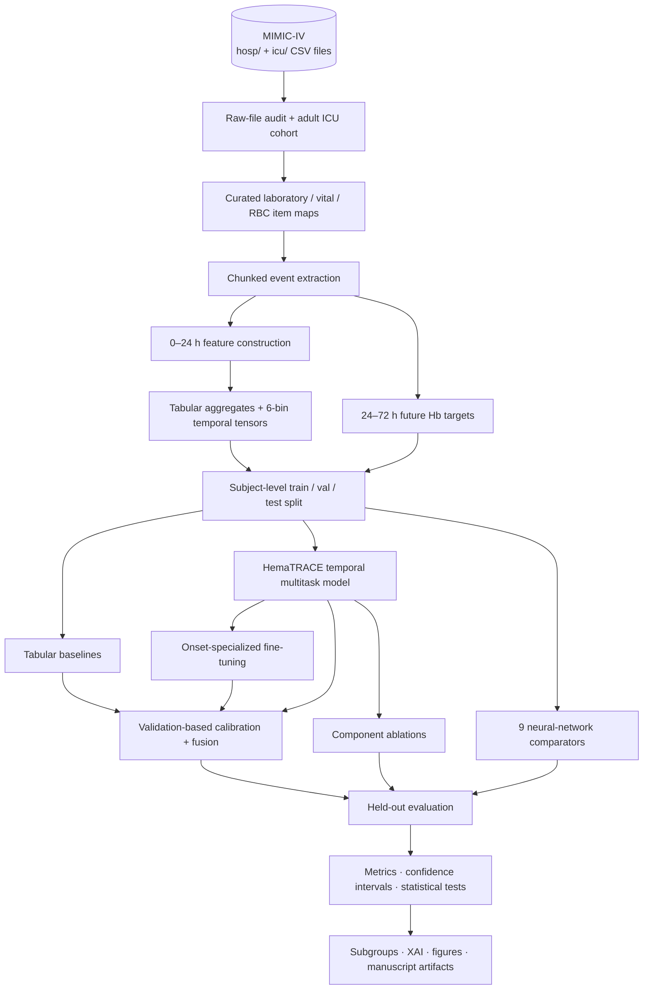
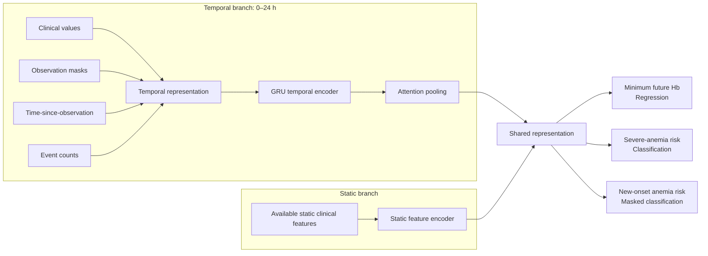
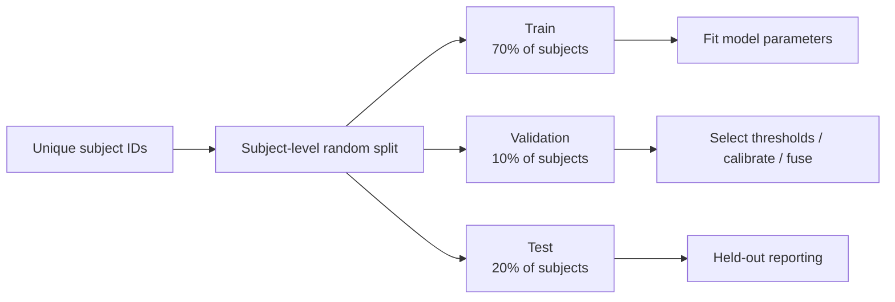

<a id="top"></a>

<h1 align="center">HemaTRACE</h1>

<h3 align="center">Temporal Hemoglobin Forecasting &amp; Anemia Risk Assessment in Critical Care</h3>

<p align="center"><strong>A reproducible, multimodal, multitask deep-learning research framework built around MIMIC-IV intensive care data.</strong></p>

<p align="center">
  
  
  
  
  
  
</p>

<p align="center">
  <a href="#quick-start">🚀 Quick Start</a> ·
  <a href="#methodology">🧠 Method</a> ·
  <a href="#dataset-access">🧬 Dataset</a> ·
  <a href="#evaluation-protocol">📊 Evaluation</a> ·
  <a href="#documentation">📚 Documentation</a> ·
  <a href="#citation">📖 Citation</a>
</p>

<p align="center">
  <a href="https://github.com/deepanshubaghel/HemaTRACE">Source Code</a> ·
  <a href="https://physionet.org/content/mimiciv/">MIMIC-IV on PhysioNet</a> ·
  <a href="https://mimic.mit.edu/">Official MIMIC Documentation</a>
</p>

---

> [!IMPORTANT]
> **Research use only.** HemaTRACE is a research implementation not a validated clinical decision-support system or medical device. It must **not** be used independently to guide patient treatment, transfusion, or clinical management. This repository does **not** distribute MIMIC-IV records, patient-level derivatives, model checkpoints, trained weights, or empirical benchmark results.

## ✨ At a glance

| 🔬 Research dimension | HemaTRACE design |
|:--|:--|
| **Clinical setting** | Adult intensive care unit (ICU) stays |
| **Observation → prediction** | **0–24 h** ICU measurements → **24–72 h** future hemoglobin outcomes |
| **Prediction objectives** | Minimum future Hb (regression), severe anemia risk, new-onset anemia risk |
| **Temporal representation** | **6 × 4-hour bins** of values, observation masks, elapsed-time information, and counts |
| **Core model** | GRU-based temporal encoder + attention + static branch + multitask prediction heads |
| **Research comparisons** | Tabular baselines, 9 deep-learning comparator architectures, retrained component ablations |
| **Analysis** | Discrimination, regression accuracy, calibration, bootstrap uncertainty, subgroups, explainability, and model complexity |
| **Reproducibility** | Patient-disjoint train/validation/test splits (**70 / 10 / 20** at the subject level) |

<details>
<summary><b>📑 Navigate this README</b></summary>

- [Overview](#overview)
- [Research problem and prediction tasks](#research-problem-and-prediction-tasks)
- [Methodology](#methodology)
- [Research experiments and model families](#research-experiments-and-model-families)
- [Quick start](#quick-start)
- [Dataset access](#dataset-access)
- [Repository structure](#repository-structure)
- [Configuration](#configuration)
- [Execution and experiment workflow](#execution-and-experiment-workflow)
- [Evaluation protocol](#evaluation-protocol)
- [Output artifacts](#output-artifacts)
- [Reproducibility and limitations](#reproducibility-and-limitations)
- [Tests and troubleshooting](#tests-and-troubleshooting)
- [Citation](#citation)
- [License, ethics, and responsible use](#license-ethics-and-responsible-use)
- [Documentation](#documentation)

</details>

---

## Overview

**Abstract.** **HemaTRACE** is a research framework for temporal hemoglobin forecasting and anemia risk prediction in critical care. Using clinical observations from the first **24 hours of an ICU stay**, HemaTRACE models future hemoglobin outcomes over **hours 24–72**. The framework integrates laboratory results, bedside physiological measurements, transfusion-related events, and eligible static clinical features using an attention-based temporal encoder and multitask prediction heads.

HemaTRACE jointly studies **three complementary research endpoints**: future minimum hemoglobin concentration, severe anemia risk, and new-onset anemia among eligible stays. A complete experimental pipeline supports conventional machine-learning baselines, neural architecture comparisons, onset-focused fine-tuning, calibration and fusion, systematic ablations, statistical analysis, interpretability, and reproducibility assessments.

**Research codebase.** This repository contains the **HemaTRACE research implementation**, from raw MIMIC-IV data processing to model development, experimental comparisons, statistical evaluation, and research figures. Its methods, operational outcome definitions, training settings, and reporting conventions are documented below to support transparent, reproducible research.

### 🎯 What this repository provides

- **🧬 End-to-end data processing:** curated MIMIC-IV item mappings, cohort construction, chunked event extraction, and temporal/tabular feature generation.
- **🧠 Multitask sequence learning:** GRU-attention modeling with a static-feature branch and three prediction objectives.
- **🔁 Controlled experiments:** subject-level splits, tabular baselines, onset specialization, fusion/calibration, nine deep-learning comparators, and component ablations.
- **📊 Publication-oriented analysis:** metrics, uncertainty estimates, statistical comparisons, subgroup analysis, XAI figures, and structured manuscript outputs.
- **🧰 Reproducible software:** a documented Python package, a single experiment entry point, dependency specifications, automated smoke tests, and technical reference guides.

---

## Research problem and prediction tasks

### ⏳ Prediction horizon

HemaTRACE uses the **first 24 hours** after ICU admission as the observation period and the following **24–72 hours** as the future outcome period.

```text
ICU admission                                                  Follow-up
     │                                                             │
  t = 0 h                       t = 24 h                        t = 72 h
     │─────────────────────────────│────────────────────────────────│
     │      OBSERVED INPUT         │        FUTURE OUTCOME          │
     │   clinical measurements     │    hemoglobin observations    │
     │                             │                                │
     │  [0–4] [4–8] [8–12]        │     ↓ minimum observed Hb     │
     │ [12–16] [16–20] [20–24]    │     ↓ severe-anemia label     │
     │       6 × 4 h bins          │     ↓ new-onset-anemia label  │
     └─────────────────────────────┴────────────────────────────────┘
            Model inputs                  Prediction targets
```

**Notation.** For ICU stay $i$, let $\mathcal H_i^{[a,b)}$ denote the available hemoglobin measurements recorded from hour $a$ (inclusive) to hour $b$ (exclusive), relative to ICU admission.

### 🧪 Three prediction objectives

| Head | Formal research definition | Objective |
|:--|:--|:--|
| **① Future minimum Hb** | $y_i^{\mathrm{Hb}} = \min\mathcal H_i^{[24,72)}$ | Continuous regression |
| **② Severe anemia** | $y_i^{\mathrm{sev}} = \mathbb{1}[y_i^{\mathrm{Hb}} < 8.0]$ | Binary classification |
| **③ New-onset anemia** | Among stays without observed anemia in hours 0–24, predict whether future minimum Hb falls below the study's sex-specific threshold | Eligible-subset binary classification |

For the third objective, the study uses the following hemoglobin thresholds for early and future anemia:

$$
\tau_i =
\begin{cases}
13.0, & \text{recorded male},\\
12.0, & \text{recorded female}.
\end{cases}
$$

- **New-onset eligibility:** an observed early Hb measurement is required, and the early minimum Hb must be **at or above** $\tau_i$.
- **Future new-onset label:** within the eligible subset, future anemia is defined by $y_i^{\mathrm{Hb}} < \tau_i$.
- **Missingness is not a negative label:** if early hemoglobin is unavailable, the new-onset outcome is undefined and excluded from its eligible subset.
- **Cohort inclusion:** at least one hemoglobin observation is required in the future **24–72 h** window to construct these targets.

> [!NOTE]
> These are **operational thresholds used by HemaTRACE** for its research tasks; they should not be interpreted as universally applicable clinical diagnostic criteria. See [`docs/DATA_AND_TARGETS.md`](docs/DATA_AND_TARGETS.md) for the complete cohort and label definitions.

---

## Methodology

### 🧭 End-to-end research pipeline



HemaTRACE starts from **raw MIMIC-IV CSV tables** and produces the cohort, features, models, and evaluation artifacts in a single research workflow. The diagram groups stages conceptually; the exact execution order is defined by [`src/hematrace/pipeline.py`](src/hematrace/pipeline.py). Each full run creates its own timestamped output directory.

### 🧠 HemaTRACE temporal architecture (conceptual)



*Conceptual diagram; consult the source for implementation-level layer details, residual connections, and the training/fusion procedures.*

### 🧱 Features and representations

| Feature source | Raw source | Modeled information |
|:--|:--|:--|
| **Laboratory** | `hosp/labevents.csv` | Hb, hematocrit, red-cell indices, platelets, WBC, renal/coagulation measures, and other curated labs |
| **Physiology** | `icu/chartevents.csv` | Heart rate, blood pressures, respiratory rate, SpO₂, temperature, GCS components |
| **Treatment** | `icu/inputevents.csv` | Curated RBC transfusion count and amount features |
| **Static** | Cohort/admission tables and early derived variables | Available demographic and admission characteristics plus permitted early observations |

For temporal modeling, each 4-hour bin contains **observed values**, **observation masks**, **time-since-observation information**, and **measurement counts**. Tabular models use 0–24-hour aggregate statistics and additional selected predictors. Curated `itemid` mappings and feature definitions are implemented in [`src/hematrace/data/`](src/hematrace/data/).

---

## Research experiments and model families

### 🔍 Models implemented

| Experiment family | Included models / procedures | Research role |
|:--|:--|:--|
| **Tabular baselines** | Ridge/logistic regression and gradient-boosting baselines, with optional LightGBM/XGBoost backends | Conventional ML reference |
| **HemaTRACE-Temporal** | GRU + attention + static branch + multitask heads | Main temporal framework |
| **HemaTRACE-OnsetSpecialized** | Fine-tuning oriented toward the eligible new-onset objective | Outcome specialization |
| **HemaTRACE-Fusion** | Temperature calibration and validation-trained prediction fusion | Probability calibration / combination |
| **Deep-learning comparators** | Static MLP, flattened temporal MLP, 1D CNN, LSTM, GRU, BiGRU, attention-based BiLSTM, Transformer encoder, TCN | Neural architecture comparisons |
| **Component ablations** | Retrained variants of input channels, attention, branches, and selected feature groups | Design sensitivity analysis |

**Neural comparator architectures:** **9**, in addition to the HemaTRACE model and task-specialized variants.

### 🧩 Ablation study coverage

The HemaTRACE ablation suite includes controlled variants that remove, disable, or mask temporal/static branches, attention, observation-mask/time/count channels, treatment inputs, and hemoglobin trend features, as specified by the experiment configurations. These comparisons are **implemented study configurations**, not claimed quantitative findings.

> [!TIP]
> **Results are intentionally not fabricated here.** The README describes the pipeline and output tables; actual performance numbers, confidence intervals, figures, and rankings must come from a completed run using an authorized and versioned dataset.

---

## Quick start

### ① Clone and create an environment

```bash
git clone https://github.com/deepanshubaghel/HemaTRACE.git
cd HemaTRACE

python -m venv .venv
source .venv/bin/activate                 # Linux / macOS
# .venv\Scripts\Activate.ps1            # Windows PowerShell

python -m pip install --upgrade pip
python -m pip install -e .
```

**Prerequisites:** Python **3.10+** and compatible dependency wheels (Python 3.11/3.12 recommended in the source documentation). A **CUDA-capable GPU** is recommended for the full research pipeline, together with sufficient RAM and storage for large CSV extracts.

**PyTorch/CUDA:** use an appropriate CUDA-enabled PyTorch wheel from the [official PyTorch installer](https://pytorch.org/get-started/locally/) if GPU acceleration is required. Installing a generic `torch` dependency alone does not guarantee CUDA support.

### ② Obtain authorized MIMIC-IV data

Complete PhysioNet credentialing and access requirements (see [Dataset access](#dataset-access)). Place the required, uncompressed `.csv` files under `Dataset/Mimic4/`, or configure `DATA_ROOT`/`MIMIC_SUBDIR` for your authorized external storage path.

```bash
python scripts/check_data.py
# To check an alternate MIMIC-IV root without changing data locations:
python scripts/check_data.py --root /secure/path/to/Mimic4
```

**Note:** the checker verifies expected filenames, not the entire dataset schema or clinical content.

### ③ Run the complete pipeline

```bash
python main.py
```

Equivalent installed entry points:

```bash
python -m hematrace
# or
hematrace-run
```

> [!WARNING]
> This starts a **full multi-stage research experiment**, not a lightweight pretrained-model prediction. It includes event extraction, feature construction, several training families, comparisons, ablations, statistical evaluation, and figure generation. Runtime and resource requirements depend on the dataset, configuration, and hardware.

<details>
<summary><b>⚙️ Alternative installation and development dependencies</b></summary>

```bash
# Install from explicit runtime requirements
python -m pip install -r requirements.txt
python -m pip install -e . --no-deps

# Optional boosting and statistics packages
python -m pip install -r requirements-optional.txt
# or: python -m pip install -e '.[all]'

# Development / testing dependencies
python -m pip install -r requirements-dev.txt
# or: python -m pip install -e '.[dev]'
```

The original tabular fallback logic may select different learners depending on the availability of LightGBM/XGBoost. Record the installed environment when reproducing experiments.

</details>

---

## Dataset access

### 🔐 MIMIC-IV: controlled-access clinical research data

This project is designed for **[MIMIC-IV](https://physionet.org/content/mimiciv/)**, a large de-identified electronic health record resource originating from Beth Israel Deaconess Medical Center and provided through **PhysioNet**. It includes information such as ICU stays, hospital admissions, laboratory events, clinical observations, and treatments.

| Official resource | Link |
|:--|:--|
| **MIMIC-IV dataset (all releases)** | [physionet.org/content/mimiciv/](https://physionet.org/content/mimiciv/) |
| **MIMIC-IV v3.1 (citation example)** | [physionet.org/content/mimiciv/3.1/](https://physionet.org/content/mimiciv/3.1/) |
| **MIMIC documentation** | [mimic.mit.edu](https://mimic.mit.edu/) |
| **PhysioNet credentialing/training** | [PhysioNet](https://physionet.org/) |

**Access requirements:** Register with PhysioNet, meet its credentialing and required human-subjects training requirements (including **CITI Data or Specimens Only Research**, when applicable to the selected release), and sign the required dataset Data Use Agreement (DUA). The **official dataset page controls the current requirements**.

> [!CAUTION]
> **No MIMIC-IV records are shipped here.** Raw clinical data, patient-level features, extracted event CSVs, per-patient predictions, and derived checkpoints must not be uploaded to public source repositories. PhysioNet specifically advises treating derived datasets and models as potentially sensitive and distributing them, if appropriate, under the applicable credentialed-access requirements.

### 📂 Required raw CSV layout

```text
Dataset/
└── Mimic4/
    ├── hosp/
    │   ├── patients.csv          ← required
    │   ├── admissions.csv        ← required
    │   ├── labevents.csv         ← required
    │   └── d_labitems.csv        ← required
    └── icu/
        ├── icustays.csv          ← required
        ├── chartevents.csv       ← required
        ├── d_items.csv           ← required
        └── inputevents.csv       ← required
```

Additional tables inspected by the file audit include hospital diagnoses, diagnosis dictionaries, prescriptions, pharmacy, eMAR, eMAR details, and ICU procedure events. See [`docs/DATA_AND_TARGETS.md`](docs/DATA_AND_TARGETS.md).

The pipeline **expects uncompressed `.csv` files**; `.csv.gz` files are not read directly by the CSV reader. On case-sensitive filesystems, preserve the exact `Dataset/Mimic4/hosp/` and `Dataset/Mimic4/icu/` naming unless you intentionally configure another location.

**Using an existing HPC dataset:** You do **not** need to copy the data inside the GitHub repository. Update `DATA_ROOT` and `MIMIC_SUBDIR` in `src/hematrace/config.py` to point to permitted secured storage. Avoid committing machine-specific absolute paths.

---

## Repository structure

```text
HemaTRACE/
├── README.md                         📘 Project documentation
├── LICENSE                           ⚖️ MIT license
├── main.py                           ▶️ Full pipeline entry point
├── pyproject.toml                    📦 Packaging and CLI
├── requirements.txt                 📦 Runtime dependencies
├── requirements-optional.txt        📦 Optional research packages
├── requirements-dev.txt             🧪 Development/test dependencies
├── Makefile
├── MANIFEST.in
├── .gitignore                        🔒 Local-data and artifact exclusions
│
├── src/hematrace/
│   ├── __init__.py
│   ├── __main__.py                   python -m hematrace
│   ├── config.py                     Configuration and result paths
│   ├── pipeline.py                   Full experiment orchestration
│   ├── utils.py                      Helpers, serialization, seeds
│   ├── metrics.py                    Regression/classification metrics
│   ├── optional_dependencies.py      Optional package fallbacks
│   ├── data/
│   │   ├── cohort.py                 Adult ICU cohort and raw audit
│   │   ├── events.py                 Chunked MIMIC-IV extraction
│   │   ├── features.py               Labels, features, splits, tensors
│   │   └── item_maps.py              Curated clinical item mappings
│   ├── models/
│   │   ├── tabular.py                Conventional predictors
│   │   ├── temporal.py               Temporal multitask network
│   │   └── fusion.py                 Calibration and fusion
│   ├── comparisons/
│   │   └── deep_learning.py          Nine deep-learning comparators
│   ├── studies/
│   │   └── ablation.py               Ablation configurations
│   ├── evaluation/
│   │   ├── statistics.py             Statistical analyses
│   │   └── explainability.py         XAI and visualizations
│   └── reports/
│       └── complexity.py             Complexity / manuscript artifacts
│
├── scripts/
│   └── check_data.py                 Dataset filename audit
├── tests/                            Synthetic, data-free smoke tests
└── docs/
    ├── ARCHITECTURE.md
    ├── DATA_AND_TARGETS.md
    └── REPRODUCIBILITY.md
```

The `Dataset/` input tree and `HemaTrace_results/` output tree are **local/runtime resources**, not files to publish as source code. The output directories are created automatically during runs.

---

## Configuration

HemaTRACE configuration is defined in `src/hematrace/config.py` (`CFG` dataclass). The table is a compact overview; the full configuration defines additional loss weights, fine-tuning controls, bootstrap settings, and plotting parameters.

| Category | Parameter | Default |
|:--|:--|:--|
| **Dataset** | `DATA_ROOT`, `MIMIC_SUBDIR` | `Dataset`, `Mimic4` |
| **Outputs** | `OUT_ROOT`, `PROJECT_NAME` | `HemaTrace_results`, `HemaTRACE_MANUSCRIPT` |
| **Temporal windows** | Input / target | `0–24 h` / `24–72 h` |
| **Sequence** | `BIN_SIZE_HOURS`, `N_BINS` | `4.0`, `6` |
| **Split** | `TRAIN_FRAC`, `VAL_FRAC`, `TEST_FRAC` | `0.70`, `0.10`, `0.20` |
| **Seed** | `RANDOM_STATE` | `42` |
| **Severe cutoff** | `SEVERE_HB_THRESHOLD` | `8.0` |
| **Anemia cutoffs** | Male / female | `13.0` / `12.0` |
| **Training** | `MAX_EPOCHS`, `PATIENCE` | `80`, `12` |
| **Batching** | `BATCH_SIZE`, `NUM_WORKERS` | `512`, `12` |
| **Optimization** | `LR`, `WEIGHT_DECAY` | `8e-4`, `1e-4` |
| **Temporal network** | Embedding / GRU hidden | `128` / `128` |
| **Static network** | Hidden / embedding | `128` / `64` |
| **Shared network** | Hidden / dropout | `192` / `0.30` |
| **Onset specialization** | Fine-tuning epochs | `35` |
| **Statistics** | `BOOTSTRAP_N` | `1000` |
| **Explainability** | `XAI_MAX_SAMPLES`, `DPI` | `2000`, `300` |
| **Debug mode** | `FAST_DEBUG` | `False` |

**Large CSV chunk sizes:** `CHUNKSIZE_LABEVENTS = 2,000,000`, `CHUNKSIZE_CHARTEVENTS = 2,000,000`, and `CHUNKSIZE_INPUTEVENTS = 1,000,000`.

> [!IMPORTANT]
> Result directories are initialized **when the configuration module is imported**. Edit path settings in `CFG` **before launching Python**, rather than changing `cfg` after import. Run from the repository root when using relative paths.

<details>
<summary><b>⚡ Development-only fast debug mode</b></summary>

In `src/hematrace/config.py`:

```python
FAST_DEBUG: bool = True
```

Existing source defaults: `FAST_DEBUG_MAX_SUBJECTS = 3000`, `FAST_DEBUG_MAX_CHUNKS = 2`, and `FAST_DEBUG_BOOTSTRAP_N = 50`.

**Warning:** debug processing samples only a limited number of early input chunks. It is not a validated miniature cohort; insufficient class counts can cause downstream training/evaluation stages to fail. Use `FAST_DEBUG = False` for research experiments.

</details>

---

## Execution and experiment workflow

The full HemaTRACE experiment runs through the following research stages:

| Phase | Research operation |
|:--|:--|
| **01** | Inspect required and optional raw dataset tables |
| **02** | Construct adult ICU cohort and future hemoglobin targets |
| **03** | Create subject-disjoint train / validation / test partitions |
| **04** | Build curated MIMIC item maps |
| **05** | Extract laboratory, chart, and input events from raw CSVs |
| **06** | Build early-window aggregates and six-bin temporal tensors |
| **07** | Fit tabular regression/classification baselines |
| **08** | Train HemaTRACE temporal multitask model |
| **09** | Fine-tune new-onset-anemia specialization |
| **10** | Fit validation-based probability calibration and prediction fusion |
| **11** | Evaluate bootstrap CIs, paired tests, threshold selection, and subgroups |
| **12** | Generate XAI figures, comparison/ablation results, complexity analysis, and publication-oriented artifacts |

No previous Step 2/3/4/4D outputs, predictions, temporal NPZ files, or saved models are required by the primary raw-data pipeline.

---

## Evaluation protocol

### 📐 Outcome-specific metrics

| Task | Evaluation measures |
|:--|:--|
| **Hemoglobin regression** | MAE ↓, RMSE ↓, R² ↑, Spearman correlation ↑ (if SciPy available) |
| **Severe / onset classification** | AUROC ↑, AUPRC ↑, macro F1 ↑, sensitivity ↑, specificity ↑, accuracy ↑ |
| **Calibration** | Brier score ↓, expected calibration error (ECE) ↓, calibration tables/plots |
| **Statistical comparison** | Bootstrap confidence intervals, paired bootstrap analyses, McNemar tests when available |
| **Robustness / interpretability** | Subgroup metrics, ablation experiments, feature attribution, decision-curve / XAI visualizations |
| **Computational analysis** | Model parameters, computational complexity descriptors, runtime summaries |

Arrows indicate the **preferred metric direction**, not observed study results.

### 🛡️ Split integrity and leakage controls



HemaTRACE splits on `subject_id` to prevent multiple ICU stays from the same patient from crossing partitions. Predictor construction is confined to the first **24 hours**; the selected temporal-model static features exclude raw future-window, discharge/death, and total-LOS fields. Calibration and fusion are fitted using validation data, with test data reserved for held-out reporting.

**Interpretation caveat:** These safeguards do not eliminate every possible form of cohort-specific bias or a substitute for independent clinical/methodological validation.

---

## Output artifacts

Each full experiment creates a timestamped output directory using the **HemaTRACE run configuration**:

```text
HemaTrace_results/
└── HemaTRACE_MANUSCRIPT/
    └── T_run_YYYY-MM-DD_at_HH-MM-SS/
        ├── data/                      Cohorts, splits, tensors, predictions
        ├── models/
        │   ├── tabular/
        │   ├── temporal/
        │   ├── onset_specialized/
        │   ├── fusion/
        │   ├── ablation/
        │   └── dl_comparators/
        ├── tables/                    Metrics / cohorts / significance
        ├── figures/{png,pdf}/         Publication figures
        ├── xai/                       Explainability artifacts
        ├── reports/                   Summary JSON / combined PDF
        ├── logs/                      Run configuration
        ├── tmp_filtered_events/       Sensitive intermediate CSVs
        └── manuscript/                Manuscript figures and tables
```

### 📄 Key generated research artifacts

| Artifact | Purpose |
|:--|:--|
| `logs/final_config.json` | Saved run configuration |
| `tables/final_raw_file_audit.csv` | Required-file inspection |
| `tables/final_cohort_flow.csv` | Cohort filtering/flow summary |
| `data/final_cohort_all.csv` | Study cohort and targets (restricted research artifact) |
| `data/final_{train,validation,test}.csv` | Subject-disjoint cohorts |
| `data/temporal_{train,validation,test}.npz` | Neural input arrays |
| `tables/final_all_model_metrics.csv` | Main model evaluation table |
| `tables/final_validation_tuned_thresholds.csv` | Validation-selected thresholds |
| `tables/final_bootstrap_ci.csv` | Bootstrap confidence intervals |
| `tables/final_paired_bootstrap_tests.csv` | Paired comparison tests |
| `tables/final_subgroup_metrics.csv` | Stratified analyses |
| `tables/final_ablation_clean_table_for_manuscript.csv` | Ablation summary |
| `tables/final_dl_model_comparison_manuscript_table.csv` | Deep-learning comparison summary |
| `tables/final_model_complexity_analysis.csv` | Complexity summaries |
| `reports/final_summary.json` | Summary of completed artifacts |
| `reports/final_combined_all_figures.pdf` | Compiled figures |
| `tables/final_output_manifest.csv` | Exported output inventory |

**Privacy note:** Files in `data/`, `models/`, `xai/`, intermediate-event directories, and some reports/figures may contain patient-level information or information derived from credentialed data. **Do not publish them without an explicit data-governance review and appropriate permission.**

---

## Reproducibility and limitations

### ✅ Reproducibility design

- Explicitly defined input/target windows, anemia thresholds, features, architectures, loss functions, random seeds, and evaluation routines.
- Explicit runtime and optional dependencies, with documented conditional selection of tabular model backends.
- Subject-level splitting and early-window versus future-outcome separation.
- Calibration/fusion selection on the validation partition.
- Integrated comparator experiments, ablations, complexity summaries, and manuscript-oriented plotting routines.
- Consistent result-directory layout and artifact naming across experiments.

### ⚠️ Interpretation and validation boundaries

- **No reported benchmark scores:** no validated MAE, AUROC, AUPRC, or model superiority is asserted without full empirical results.
- **Publication status:** no peer-reviewed HemaTRACE paper, venue, or DOI is claimed in this README without an associated verified publication.
- **No clinical validation:** the implementation is not an approved clinical prediction tool.
- **No bitwise determinism guarantee:** `cudnn.benchmark` is enabled; random seeding does not guarantee identical GPU results across environments.
- **No complete data run in the repository:** the restricted dataset is not included, and smoke tests do not establish end-to-end empirical reproducibility.

**Reproduction checklist:** record the MIMIC-IV **version**, code **commit SHA**, Python/PyTorch/CUDA versions, optional boosting package versions, hardware, random seed, run configuration, and selected output manifest. Different dataset releases can change underlying identifiers and tables.

For further details, see [`docs/REPRODUCIBILITY.md`](docs/REPRODUCIBILITY.md).

---

## Tests and troubleshooting

### 🧪 Minimal code validation (no patient data)

```bash
python -m pip install -e '.[dev]'
python -m pytest -q
python -m compileall -q src main.py
python scripts/check_data.py
```

The included synthetic smoke tests cover metrics, model forward shapes, subject-level splitting, and comparator implementation selection. A successful smoke test is **not** an end-to-end MIMIC-IV research validation.

### 🩺 Common issues

| Problem | What to check |
|:--|:--|
| `MIMIC root not found` | Dataset path, working directory, and `CFG.DATA_ROOT`/`MIMIC_SUBDIR` |
| Missing required MIMIC CSV | Exact `.csv` filenames and `python scripts/check_data.py` |
| `ModuleNotFoundError: hematrace` | Activate the environment; run `python -m pip install -e .` |
| CUDA unavailable | GPU allocation, driver, and compatible CUDA-enabled PyTorch |
| Very slow training / out-of-memory | Available GPU RAM, system RAM, disk, data size, worker count |
| DataLoader process failures | `NUM_WORKERS` relative to your compute environment |
| Different tabular baseline selected | Optional LightGBM/XGBoost installation and package versions |
| Unavailable AUC in debug runs | Insufficient positive/negative examples in small sampled data |
| Incompatible CSV schema | Confirm MIMIC-IV release, headers, and decompression |

---

## Citation

### 📚 Dataset citation

If your experiments use **MIMIC-IV v3.1**, cite the specific dataset release:

> Johnson, A., Bulgarelli, L., Pollard, T., Gow, B., Moody, B., Horng, S., Celi, L. A., & Mark, R. (2024). **MIMIC-IV (version 3.1)**. *PhysioNet*. https://doi.org/10.13026/kpb9-mt58

Also cite the original MIMIC-IV scientific paper:

> Johnson, A. E. W., Bulgarelli, L., Shen, L., et al. (2023). **MIMIC-IV, a freely accessible electronic health record dataset**. *Scientific Data*, **10**, Article 1. https://doi.org/10.1038/s41597-022-01899-x

> [!IMPORTANT]
> **Use the citation corresponding to the dataset version actually used.** **MIMIC-IV v3.1 is shown as a citation example**; do not assume it is the release used for a particular HemaTRACE run. Cite the exact dataset version employed in your experiments.

<details>
<summary><b>📋 BibTeX — MIMIC-IV v3.1</b></summary>

```bibtex
@article{PhysioNet-mimiciv-3.1,
  author  = {Johnson, Alistair and Bulgarelli, Lucas and Pollard, Tom and
             Gow, Brian and Moody, Benjamin and Horng, Steven and
             Celi, Leo Anthony and Mark, Roger},
  title   = {{MIMIC-IV}},
  journal = {{PhysioNet}},
  year    = {2024},
  month   = oct,
  note    = {Version 3.1},
  doi     = {10.13026/kpb9-mt58},
  url     = {https://doi.org/10.13026/kpb9-mt58}
}
```

</details>

### 🧾 Citing HemaTRACE

**Please cite HemaTRACE** when using or extending this framework. Until an associated peer-reviewed publication or citable software archive is available, reference the **HemaTRACE GitHub repository** together with its **commit SHA or version tag** and **access date**. An official manuscript citation and BibTeX record can be added once the publication metadata are confirmed.

**Repository:** [github.com/deepanshubaghel/HemaTRACE](https://github.com/deepanshubaghel/HemaTRACE)

---

## License, ethics, and responsible use

### ⚖️ Software license vs. dataset permissions

| Resource | Applicable terms |
|:--|:--|
| **HemaTRACE source code** | [MIT License](LICENSE), subject to the repository's licensing and code-ownership rights |
| **MIMIC-IV database** | PhysioNet credentialed-access terms and applicable Data Use Agreement |
| **Derived cohorts, patient-level outputs, and trained models** | Treat as potentially sensitive; follow PhysioNet requirements and institutional review before any sharing |

The **MIT License does not grant permission to redistribute MIMIC-IV data** or override PhysioNet's DUA. Data access is **not** bundled with software access.

### 🔒 Responsible research commitments

- 🔐 Keep raw MIMIC-IV files and derived patient-level records in approved secure storage.
- 🚫 Never upload patient-level content into public commits, issues, pull requests, screenshots, or support requests.
- 🧾 Verify citation, dataset-release provenance, and local institutional approvals before dissemination.
- 🩺 Do not represent HemaTRACE predictions as validated clinical advice or deploy them for patient management without appropriate independent validation, oversight, and approvals.
- 🤝 When reusing the software, retain the relevant copyright and permission notice according to the MIT License.

---

## Documentation

| Guide | Topics |
|:--|:--|
| [🏗️ Architecture](docs/ARCHITECTURE.md) | Modules, neural structure, and pipeline integration |
| [🧬 Data & targets](docs/DATA_AND_TARGETS.md) | Cohort criteria, source tables, observation/label windows |
| [🔁 Reproducibility](docs/REPRODUCIBILITY.md) | Validation setup, environment controls, limitations |

**Contributions and research questions:** GitHub issues and pull requests can be used for **code-only** bug reports or improvements, without restricted records, hidden credentials, or clinical extracts.

---

<p align="center"><strong>HemaTRACE · Temporal learning for hemoglobin and anemia-related research in critical care</strong></p>
<p align="center"><em>Reproducible code · Explicit prediction windows · Responsible handling of clinical data</em></p>
<p align="center"><a href="#top">⬆ Back to top</a></p>
